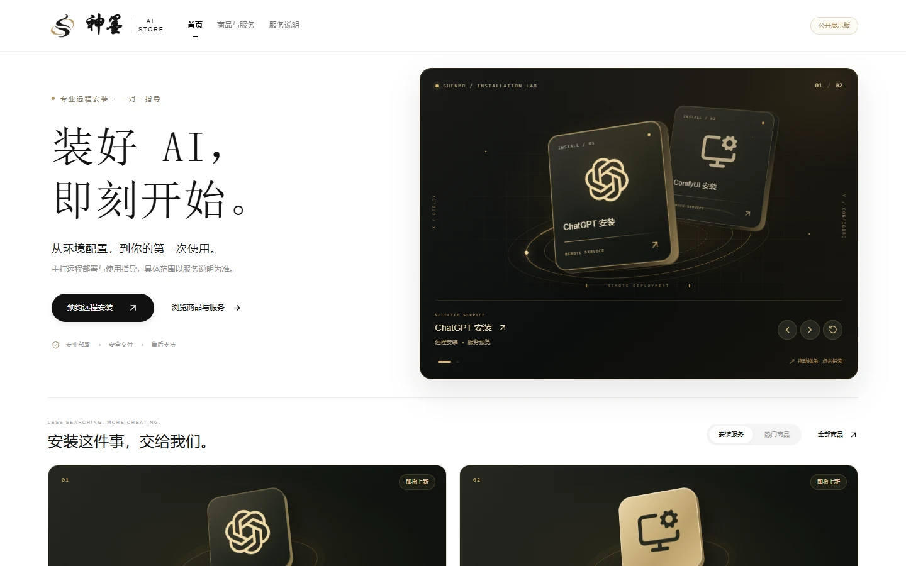

# LUO-center · Shenmo AI Store

[简体中文](README.md) · [Project site](https://luocenter306-alt.github.io/LUO-center/) · [Live demo](https://luocenter306-alt.github.io/LUO-center/shenmo.html) · [Store development and deployment (Chinese)](shenmo/store/README.md)

Shenmo AI Store is a storefront for AI tools, digital products, and remote installation services. The repository includes a standalone interactive demo and a full-stack store backed by a database.

## Preview

[](https://luocenter306-alt.github.io/LUO-center/shenmo.html)

[View the mobile screenshot](docs/assets/previews/shenmo-mobile.webp) · [Download the standalone HTML](https://raw.githubusercontent.com/luocenter306-alt/LUO-center/main/docs/shenmo.html)

## Features

| Area | Capabilities |
| --- | --- |
| Interactive demo | Drag, touch, or use the keyboard to explore 3D items. Browse categories, search, sort by price, and open product details from the exported catalog snapshot. |
| Full-stack store | Email or phone accounts, product review and orders, license-key management, installation bookings and assignments, support tickets, wallets, and reseller applications. |
| Administration | Manage products, categories, announcements, site content, and product layouts. Import the Prome catalog for display and review. |

Live payments have yet to be integrated. The demo is for browsing. Accounts, orders, and administration require the full-stack runtime.

## Technology

- **Demo** · Standalone HTML, CSS, and JavaScript with embedded images and other assets for offline use.
- **Store UI** · TypeScript, React 19, Vinext on Vite, and CSS 3D for the product stage.
- **Store backend** · Cloudflare Workers, D1 (SQLite), and Drizzle schema and migrations.

## Repository layout

```text
LUO-center/
├── README.md                  # Chinese project guide
├── README.en.md               # English project guide
├── docs/                      # GitHub Pages publishing directory
│   ├── index.html             # Project site
│   ├── shenmo.html            # Standalone interactive demo
│   └── assets/                # Site stylesheet and desktop/mobile screenshots
└── shenmo/
    ├── index.html             # Compatibility entry point for the old path
    └── store/                 # Full-stack store source
        ├── app/               # Pages, interactions, and API routes
        ├── components/, hooks/, lib/  # UI components, hooks, and business logic
        ├── db/, drizzle/      # Schema, catalog snapshot, and migrations
        ├── public/            # Store images and brand icons
        └── scripts/, tests/   # Development scripts and business tests
```

## Run locally

**Offline demo** · Download [docs/shenmo.html](https://raw.githubusercontent.com/luocenter306-alt/LUO-center/main/docs/shenmo.html), save it as an `.html` file, and open it in a browser.

**Project site** · Run the following in the repository root with Python 3, then visit `http://127.0.0.1:8000/`.

```bash
python -m http.server 8000 --bind 127.0.0.1 --directory docs
```

**Full-stack store** · Use Node.js 22.13+ and npm. Run these commands from the repository root to build the store and initialize a fresh local D1 database.

```bash
cd shenmo/store
npm ci
npm run build
node --import ./scripts/sites-env.mjs ./node_modules/wrangler/bin/wrangler.js d1 execute DB --local --config dist/server/wrangler.json --persist-to .wrangler/state --file drizzle/0000_whole_newton_destine.sql
node --import ./scripts/sites-env.mjs ./node_modules/wrangler/bin/wrangler.js d1 execute DB --local --config dist/server/wrangler.json --persist-to .wrangler/state --file drizzle/0001_business_constraints.sql
node --import ./scripts/sites-env.mjs ./node_modules/wrangler/bin/wrangler.js d1 execute DB --local --config dist/server/wrangler.json --persist-to .wrangler/state --file drizzle/0002_romantic_fat_cobra.sql
node --import ./scripts/sites-env.mjs ./node_modules/wrangler/bin/wrangler.js d1 execute DB --local --config dist/server/wrangler.json --persist-to .wrangler/state --file drizzle/0003_amused_energizer.sql
npm start
```

Open `http://127.0.0.1:8787/`. For an existing local database, apply only the migrations you have yet to run. See the [store setup guide (Chinese)](shenmo/store/README.md#技术与运行) for environment settings.

## Deploy to GitHub Pages

In **Settings → Pages**, select **Deploy from a branch** and choose **`main` → `/docs`**. Pages serves the static files directly. `docs/index.html` is the site entry point, and the demo remains at `/LUO-center/shenmo.html`. Check **Actions → pages build and deployment**, then open the [project site](https://luocenter306-alt.github.io/LUO-center/) and the [live demo](https://luocenter306-alt.github.io/LUO-center/shenmo.html). The full-stack store has its own [hosting instructions (Chinese)](shenmo/store/README.md#全栈部署). [GitHub Pages publishing guide](https://docs.github.com/en/pages/getting-started-with-github-pages/configuring-a-publishing-source-for-your-github-pages-site)

See the [third-party notices](shenmo/store/THIRD_PARTY_NOTICES.md) for attribution and licensing details.
