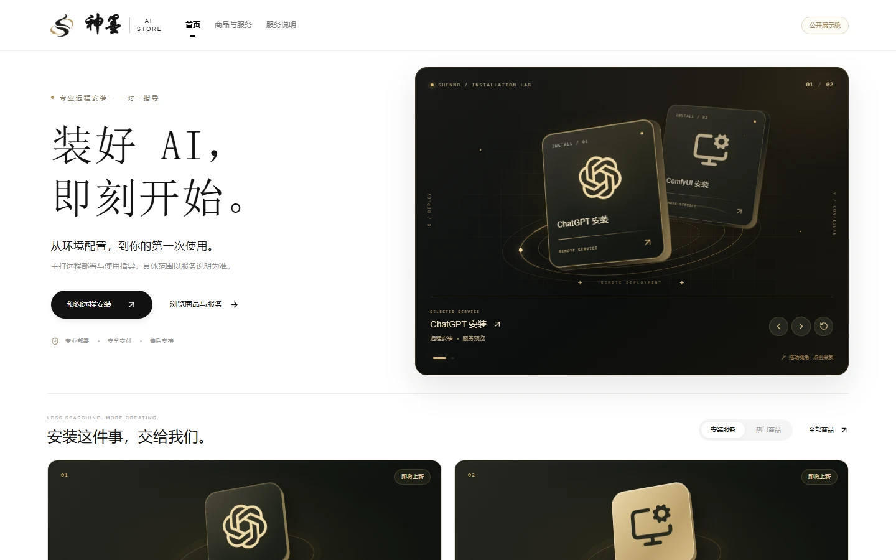

# LUO-center · 神墨 AI STORE

[English](README.en.md) · [项目主页](https://luocenter306-alt.github.io/LUO-center/) · [在线演示](https://luocenter306-alt.github.io/LUO-center/shenmo.html) · [商城开发与部署](shenmo/store/README.md)

神墨 AI STORE 是一个面向 AI 工具、数字商品与远程安装服务的商城项目。仓库同时提供可离线打开的互动展示，以及可连接数据库运行的全栈商城。

## 项目预览

[](https://luocenter306-alt.github.io/LUO-center/shenmo.html)

[查看手机端截图](docs/assets/previews/shenmo-mobile.webp) · [下载独立 HTML](https://raw.githubusercontent.com/luocenter306-alt/LUO-center/main/docs/shenmo.html)

## 功能

| 范围 | 功能 |
| --- | --- |
| 互动演示 | 拖动、触摸或用键盘切换首页 3D 展品，浏览分类、搜索商品、按价格排序和查看详情。演示使用导出的商品目录快照。 |
| 全栈商城 | 邮箱或手机号账号、商品审核与订单、卡密管理、安装预约与派单、售后工单、钱包和代理申请。 |
| 管理后台 | 管理商品、分类、公告、站点文案和商品布局，支持导入 Prome 商品目录。导入目录仅供展示与审核。 |

真实支付尚未接通。演示页面仅供浏览，账号、订单和管理功能需要运行全栈服务。

## 技术栈

- **展示页**使用独立 HTML、CSS 和 JavaScript，图片与交互资源内嵌，可在无网络时打开。
- **商城前端**使用 TypeScript、React 19 和 Vinext（运行在 Vite 上），3D 商品展示使用 CSS 3D。
- **商城后端**运行在 Cloudflare Workers 上，使用 D1（SQLite）和 Drizzle 管理数据结构与迁移。

## 仓库结构

```text
LUO-center/
├── README.md                         # 中文项目说明
├── README.en.md                      # 英文项目说明
├── docs/                             # GitHub Pages 发布目录
│   ├── index.html                    # 项目主页
│   ├── shenmo.html                   # 独立互动演示
│   └── assets/                        # 主页样式与桌面、手机实拍截图
└── shenmo/
    ├── index.html                    # 旧路径兼容入口
    └── store/                        # 全栈商城源码
        ├── app/                      # 页面、交互与 API 路由
        ├── components/、hooks/、lib/  # UI 组件、Hooks 和业务逻辑
        ├── db/、drizzle/              # 数据模型、目录快照与迁移
        ├── public/                   # 商城图片与品牌图标
        └── scripts/、tests/           # 运行辅助脚本与业务测试
```

## 本地运行

**离线演示** · 下载 [docs/shenmo.html](https://raw.githubusercontent.com/luocenter306-alt/LUO-center/main/docs/shenmo.html)，保存为 `.html` 文件后用浏览器打开。

**项目主页** · 从仓库根目录运行以下命令，访问 `http://127.0.0.1:8000/`。需要 Python 3。

```bash
python -m http.server 8000 --bind 127.0.0.1 --directory docs
```

**完整商城** · 需要 Node.js 22.13+ 和 npm。首次启动还需要初始化 D1。构建、四项迁移、启动与环境变量见[商城开发与部署](shenmo/store/README.md#技术与运行)。

## GitHub Pages 部署

在仓库 **Settings → Pages** 选择 **Deploy from a branch**，来源设为 **`main` → `/docs`**。Pages 直接发布静态文件，入口是 `docs/index.html`，商城演示继续使用 `/LUO-center/shenmo.html`。部署后可在 **Actions → pages build and deployment** 查看结果，并访问[项目主页](https://luocenter306-alt.github.io/LUO-center/)和[演示页](https://luocenter306-alt.github.io/LUO-center/shenmo.html)。全栈商城单独部署，参见[商城部署说明](shenmo/store/README.md#全栈部署)。[GitHub Pages 发布来源文档](https://docs.github.com/zh/pages/getting-started-with-github-pages/configuring-a-publishing-source-for-your-github-pages-site)

品牌图标及第三方组件的授权信息见[第三方声明](shenmo/store/THIRD_PARTY_NOTICES.md)。
